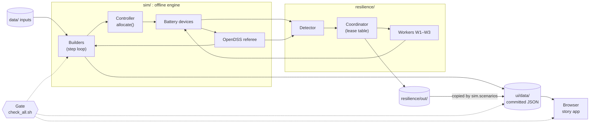

# Architecture

Batter Up has three layers. An offline Python engine runs every scenario ahead of time, with OpenDSS as the referee. A
folder of committed JSON carries every number with its provenance label. A static web app only reads that JSON.

**Interactive version.** Open [`architecture.html`](architecture.html) in a browser. It is one self-contained file and
needs no server: double-click it, or run `start architecture.html` on Windows, `open architecture.html` on macOS or
`xdg-open architecture.html` on Linux. Pick a flow tab, then step with the arrow keys or press Space to play. Press `O`
to switch between the replay and live modes. This page covers the same components and flows in text, so it stands on
its own.

## The system at a glance



Two things to read off the picture:

- **No arrow joins the Controller to OpenDSS.** The controller acts on its own view of transformer load. OpenDSS solves
  every step afterwards, and every violation comes from its result.
- **The arrow into `ui/data/` is a file, not a service.** The engine commits its output ahead of time. The browser
  fetches static JSON and never computes a physics result. There is no server, no database and no network call at
  view time.

## Components

The role names match the colour legend in `architecture.html`.

| Component | Where | Role | What it does |
|---|---|---|---|
| data/ inputs | `data/` | Files | The SMART-DS feeder (`smartds/`), a synthetic Oncor-suburb stand-in at LZ_NORTH, home load profiles (`profiles/`), ERCOT LZ_NORTH prices (`ercot/`), the frozen 96-battery fleet (`fleet.json`) and the planner's inputs (`planner/`). Each source has a `SOURCE.md` with its origin, licence and sha256. |
| Builders | `sim/p1_build.py`, `history.py`, `chaos.py`, `scenarios.py`, `p2_build.py`, `referee.py`, `planner.py` | Step loop | Run the time-stepped simulation. Each writes one family of `ui/data/` files (see [What each builder writes](#what-each-builder-writes)). |
| Controller | `sim/orchestrator.py` (`Controller`, `allocate()`), `sim/caps.py` | Decides | Splits the fleet target across batteries, transformer by transformer, from its own 60 s lagged view. |
| Battery devices | `sim/devices.py` | Simulated world | Accept a command only if its sequence number is newer, idle with backup armed when it expires, and never go below the 20% member reserve. |
| OpenDSS referee | `sim/feeder.py` (OpenDSSDirect.py 0.9.4), `sim/tiers.py` | Simulated world | Solves the AC power flow of the 379-transformer, 1,010-customer feeder. `tiers.py` turns its loading into tiers and violations. |
| Coordinator | `resilience/runtime/engine.py`, `lease.py`, `partition.py` | Coordinator | Leases three transformer groups to workers, splits the fleet target across groups, delivers commands and runs OpenDSS every step. |
| Workers W1–W3 | `resilience/runtime/worker.py`, `live.py` | Decides | Each runs the unchanged `Controller` for the groups it leases and stamps every command with the lease epoch. |
| Detector | `resilience/detect/detector.py` (the fictional attack is in `attack.py`) | Decides | Flags hidden modulation from telemetry and each home's own meter voltage, never from a privileged solve. |
| resilience/out/ | `resilience/out/p1/`, `resilience/out/p3/` | Files | The committed resilience replays. A live run writes to `resilience/out/live/` instead, which git ignores. |
| ui/data/ | `ui/data/` | Files | The committed JSON the app reads: the only interface between the engine and the app. |
| Browser (story app) | `ui/index.html`, `ui/story/`, `ui/lib/` | Viewer | Static pages that read `ui/data/` and render every number with its label. Served by `scripts/serve.sh` on port 8765 or by Vercel. |
| Gate | `scripts/check_all.sh` | Gate | Unit, Node, contract, verify and browser smoke tests. `--full` adds a rebuild that must be byte-identical. |

`resilience/` imports `sim/`; `sim/` never imports `resilience/`. The committed replay files are the only link back.

## Flows

Each flow below is a tab in `architecture.html`, with the same steps in the same order. A step reads "sender → receiver".

### 1. Build an evening (`python -m sim.p1_build`)

The core loop. The demo evening is 23 Aug 2026, 16:00 to 04:00: 720 steps of 60 s, with OpenDSS solving every step of
every branch. The branches are `none` (no batteries), `naive` (our assumption of one number with no feeder check),
`aware` (the controller) and `aware_faults` (three scripted failures).

1. **data/ inputs → Builders.** The builder reads only committed files. Their sha256 hashes go into every output file,
   so a reader can tell which inputs made a number.
2. **Builders → Controller.** Each minute the controller gets last minute's transformer load, a 60 s lag
   (ASSUMPTION), and the fleet target. The target is DERIVED from REAL prices by our rule in `sim/prices.py`.
3. **Controller → Battery devices.** `allocate()` first relieves any overloaded transformer with its own batteries.
   It then grants charge in turn, lowest state of charge first, never past each transformer's headroom. Every command
   carries a sequence number and a 300 s expiry (ASSUMPTION).
4. **Battery devices → OpenDSS referee.** The devices apply their rules: sequence, expiry, the charge taper and the 20%
   reserve. What they actually draw goes into the circuit with that minute's home loads.
5. **OpenDSS referee → Builders.** The solve returns each transformer's loading, the lowest voltage at every home, and
   the feeder-head current and power.
6. **Builders → ui/data/.** After the window, `sim/tiers.py` computes tiers (100, 110 and 150% of nameplate),
   violations and protection. `sim/money.py` computes gross energy value. The builder writes
   `ui/data/p1/{meta,none,naive,aware,aware_faults}.json`, each inside the labelled envelope. On this evening the
   feeder-aware branch peaks at 119.5% of nameplate with 0 battery-caused events (SIM).

The other evening builders reuse this loop. `sim.history` runs 22 Jul, 14 Aug and 26 Aug. `sim.scenarios` runs the
fleet-lever variants. `sim.chaos` runs 50 seeded failure runs of the feeder-aware evening.

### 2. Watch a scenario (`ui/index.html`)

1. **Builders → ui/data/.** Ahead of time, `sim.scenarios` writes the catalogue of 51 scenarios
   (`ui/data/story/index.json`), each pointing at its own files. A change reaches the live site only through a
   redeploy.
2. **ui/data/ → Browser.** `ui/story/app.js` routes on the URL and loads the catalogue. Configure offers only runs the
   engine made, and says why each missing combination was not run.
3. **ui/data/ → Browser.** Run, Results and Learnings load the scenario's branch and extras files and gunzip
   `.json.gz` in the browser. `ctx.num()` renders every value with its provenance tag and throws on a bare number.

The scenario id travels in the URL, so every page shows the same run:

```
ui/index.html?page=configure|running|run|results|learnings&s=<scenario id>&k=<step>&speed=<x>&q=<1-4>&tf=<index>&n=<0-50>
```

Scenario ids read `<evening>/<policy>[/<failure>][/<lever>=<value>]`, for example `2026-08-23/aware`,
`2026-08-23/aware/covert` or `2026-08-23/naive/fleet=192`.

**What runs in the browser:** formatting, scaling, sorting, counting rows for map legends, and the planner's seeded
Monte Carlo upgrade decision. No physics and no violation logic run in the browser.

### 3. Controller crash (`python -m resilience.runtime.build`)

23 Aug with feeder-aware charging. A worker is killed while it holds a group of transformers, and another takes over.

1. **Coordinator → Workers.** The coordinator leases three transformer groups for 300 s (ASSUMPTION): G1 to W1 with 32
   batteries, G2 to W2 with 31, G3 to W3 with 33, all at epoch 1. Each worker runs the unchanged `Controller`.
2. **Workers → Battery devices.** Every command carries the lease epoch and a sequence number that restarts at 1 with
   each grant. A device rejects a command from an older epoch, a non-increasing sequence in the same epoch, or a
   command that expired before it arrived.
3. **Battery devices → OpenDSS referee.** The runtime uses the evening build's inputs, view, target formula, device
   rules and protection rule. OpenDSS judges all 720 minutes.
4. **Coordinator → Workers.** At 22:20, 20 minutes after charging starts (ASSUMPTION), W2 is killed while it holds G2.
   At 22:24 the lease runs out and the coordinator gives G2 to W1 at epoch 2: a takeover after 240 s (SIM). W1 starts
   from a fresh `Controller`, so dwell and flip memory do not survive the takeover.
5. **Workers → Battery devices.** W2's last batch of 31 commands lands right after W1's. None had expired, so only the
   epoch could stop them, and the devices refused all 31 (SIM). A device that checked sequence numbers alone would
   have accepted all 31.
6. **Coordinator → resilience/out/.** The replay `resilience/out/p1/worker_kill.json` is an ordinary branch file plus
   a labelled summary and a runtime block. The summary shows 0 battery-caused events, 0 reserve breaches and the fleet
   fully charged by 04:00 (SIM).
7. **resilience/out/ → ui/data/.** `sim.scenarios` copies it byte for byte to `ui/data/p1/worker_kill.json`, with the
   catalogue id `2026-08-23/aware/worker_kill`.
8. **Coordinator → resilience/out/live/.** In live mode only. See [Modes](#modes-replay-and-live).

### 4. Hidden attacker (`python -m resilience.detect.build`)

The attacker is fictional. This flow has no live mode.

1. **Coordinator → Workers.** The same evening runs three times with no worker failure: clean, attacked with the
   detector watching, and attacked with quarantine. The noise is seeded identically, so the runs differ only by the
   attack and the response.
2. **Workers → Battery devices.** From 22:30, 24 dense-cohort batteries on 16 transformers (ASSUMPTION) follow every
   legitimate command and add a hidden ±0.35 kW offset that flips sign every minute. The phase of each 5-minute symbol
   carries one bit. The command log shows nothing unusual, and the 20% reserve still holds.
3. **Battery devices → OpenDSS referee.** The offset is real power, so it shows up in the voltage at those homes: a
   median of 0.0002655 pu against 0.0000127 pu without the attack (SIM). This is a simulation reference; the detector
   never reads it.
4. **Battery devices → Detector.** Over the last 10 one-minute samples, the residual between reported kW and setpoint
   must exceed 0.18 kW rms and must oscillate, with lag-1 autocorrelation below −0.75. A legitimate shortfall, such as
   the charge taper, is smooth and never qualifies.
5. **OpenDSS referee → Detector.** The home's own meter voltage must carry the same carrier above 0.0001 pu, counted
   only in quiet 4-minute windows when no battery on that transformer changed setpoint.
6. **Detector → Coordinator.** The detector flags all 24 compromised units, the first 180 s after the channel opens and
   the last after 900 s, with 0 false positives on the clean fleet (SIM). In the quarantine run each flagged unit is
   held at zero from the next minute and cut from the fleet target.
7. **Coordinator → resilience/out/.** The replay `resilience/out/p3/covert.json` holds the attack, the flags, the
   quarantine log and the labelled summary. OpenDSS finds 0 battery-caused events in all three runs.
8. **resilience/out/ → ui/data/.** `sim.scenarios` copies it byte for byte to `ui/data/p3/covert.json`. Results shows
   one recorded ERCOT frequency day (25 Sep 2026, REAL) beside it, marked as a different day. A 1,000-battery hijack
   would move ERCOT frequency by a 3–17 mHz band (DERIVED), inside normal wander.

### 5. Where the next battery goes (`sim.p2_build`, `sim.referee`, `sim.planner`)

1. **data/ inputs → Builders.** P2 replays August 2026 at 15-minute steps for 16 combinations of policy, battery class,
   charge-onset rule and load growth. The planner models 0 to 50 Cores on each transformer.
2. **Builders → Controller.** `sim.siting.per_tf_rule()` is the controller's rule without memory, sharing
   `transformer_caps()`. A test holds it equal to `allocate(state=None, cover=False)` within 1e-6. A fast
   per-transformer loading estimate (`sim/surrogate.py`) stands in for OpenDSS at this stage, labelled SCREENING.
3. **Builders → OpenDSS referee.** `sim.referee` runs whole August months in OpenDSS for the shortlisted placements.
   Its numbers merge only when the sha256 of the battery schedules it judged matches the build's; otherwise every card
   stays SCREENING. The estimate's error against OpenDSS on the shortlist is at most 0.69 points (SIM).
4. **Builders → ui/data/.** P2 writes `ui/data/p2/index.json` and 16 combo files. The planner writes
   `ui/data/p2/planner.json`: capacity per transformer, loading and earnings for 0 to 50 Cores at three growth levels,
   and the upgrade ranking. Where OpenDSS checked a capacity, its number is the one shown.
5. **ui/data/ → Browser.** Learnings shows capacity, one transformer's curve as batteries are added, and the upgrade
   ranking. The upgrade card's decision runs in the browser as a seeded Monte Carlo (`decide()` in `ui/lib/planner.js`).

The score adds a grid lens to install planning. Base schedules installs by marketplace demand and installer
availability, and does not sell this score today.

### 6. The gate (`scripts/check_all.sh`)

There is no CI; this script is the gate. It ends with exactly one line: `ALL CHECKS: PASS` or `ALL CHECKS: FAIL`.

1. **Gate → Builders.** Python unit tests run over `sim/tests/` (27 files), plus the archived prototypes' own tests.
   With `--full`, the gate rebuilds every artifact under the heavy-run lock and fails if committed data changes by a
   single byte.
2. **Gate → ui/data/.** `sim.contracts` checks every file's envelope, shape and labels, a 40 MB total and a 4 MB cap per
   file. `sim.verify labels`, `p1` and `p2` re-derive what they can from the committed files.
3. **Gate → Browser.** Node tests run over `ui/test/` (11 files). Headless Chrome then opens the app over CDP and fails
   on any console error or off-site request. The app reports its health on `<body>` (`data-status`, `data-errors`),
   which is what the smoke test reads.

## Modes: replay and live

The toggle at the top of `architecture.html` switches between the two ways the resilience runtime can run. Only the
Controller crash flow changes. The Hidden attacker flow is replay only, and the other flows are the same in both modes.

| | Replay (default) | Live runtime (`--live`) |
|---|---|---|
| Workers | Stepped in the coordinator's process, in worker-id order, on the simulation clock | Three real processes (multiprocessing, spawn start method) talking to the coordinator over queues |
| Liveness | Every live worker answers every step; only the killed one stops | A worker that has not replied 2 s after a step misses that heartbeat (ASSUMPTION) |
| The kill | W2's last batch is held back and W2 is removed | `terminate()` on W2's process; around the kill the clock runs at 0.5 s of wall time per 60 s step |
| Output | `resilience/out/p1/worker_kill.json`, committed, byte-identical on rebuild | `resilience/out/live/p1/worker_kill.json`, git-ignored, with wall-clock fields |
| Reaches the app | Yes: `sim.scenarios` copies it into `ui/data/` | Never |

The live runtime records to the same replay format, so the demo never depends on it being up.

## Principles the architecture enforces

| Principle | Where it is enforced |
|---|---|
| **OpenDSS judges, the controller only acts.** The controller works from its own view of transformer load (total load, 60 s lag, ASSUMPTION). OpenDSS solves every step afterwards, and every violation comes from its result. | `sim/orchestrator.py` never calls OpenDSS; `sim/feeder.py`, `sim/tiers.py` |
| **Every number is labelled.** Each value is `{v, label, cite}` with label REAL, SIM, DERIVED or ASSUMPTION; SCREENING marks what OpenDSS did not check. A bare number fails the build and throws in the browser. | `sim/contracts.py`, `sim.verify labels`; `ctx.num()` in `ui/story/shell.js` |
| **Every constant is named once**, with its label and cite. | `const()` in `sim/constants.py` and `resilience/constants.py` |
| **No language model sets a number.** Deterministic code decides every charge command, base point and rank. | Nothing in the pipeline calls a model |
| **The 20% member reserve is a hard constraint**, in every scenario including failures. | The discharge limit in `allocate()` and the devices; `sim/p1_build.py` refuses a reserve below 20% |
| **Transformer limits are nameplate as shipped**, in three tiers (100 / 110 / 150%), never de-rated. | `sim/tiers.py` |
| **Replay, not live.** The demo plays committed runs; the one live runtime records to the same format. | `ui/` reads only `ui/data/`; `resilience/runtime/live.py` writes to `resilience/out/live/` |
| **Reproducible builds.** A rebuild on the same inputs is byte-identical. OpenDSS warm-starts each solve from the last solution, so every job starts on a fresh circuit and runs its branches in a fixed order. | `sim/scenarios.py` (one job, one circuit); `scripts/check_all.sh --full` byte-compares |

## Walking someone through it

Short click paths through `architecture.html` for a demo or a review:

- **Why OpenDSS is the referee.** Open flow 1. Step 2 shows what the controller sees; step 5 shows what OpenDSS reports.
  No step ever joins the two.
- **Why the app cannot invent a number.** Open flow 2, step 3, then flow 6, step 2. A bare number fails the gate and
  throws in the browser.
- **How a crash is survived.** Open flow 3 and step to 4 and 5. Then press `O` to see what changes when the workers are
  real processes.
- **How an attack is caught from physics.** Open flow 4, steps 4 to 6. The third gate reads the home's own meter
  voltage, not the command log.
- **Where the planner's numbers come from.** Open flow 5, steps 2 and 3: the same headroom rule as the controller, and
  OpenDSS checking the shortlist.

## Reference

### What each builder writes

| Command | Writes | Contract |
|---|---|---|
| `python -m sim.topology` | `ui/data/topology.json` (feeder map, customer counts and use), `data/fleet.json` | `docs/contracts.md` A.4 |
| `python -m sim.p1_build` | `ui/data/p1/{meta,none,naive,aware,aware_faults}.json` (23 Aug) | A.5, A.6, A.5r |
| `python -m sim.history` | `ui/data/p1/days/`: three more evenings, `index.json`, `calendar.json` | A.5h, A.6h, A.9h, A.10 |
| `python -m sim.chaos` | `ui/data/p1/chaos.json`: 50 seeded failure runs | A.6a |
| `python -m sim.scenarios` | `ui/data/p1/variants/` (12 fleet-lever variants), `ui/data/p1/extras/` (per-scenario exports), `ui/data/story/index.json` (the catalogue); copies `resilience/out/` into `ui/data/p1/worker_kill.json` and `ui/data/p3/covert.json` | A.12 |
| `python -m sim.p2_build` | `ui/data/p2/index.json` + 16 combos, `data/out/siting-2026-08.csv` | A.7, A.8 |
| `python -m sim.referee` | `data/out/referee-2026-08.json`: OpenDSS months for the P2 shortlist, merged into `ui/data/p2/` | A.7 |
| `python -m sim.planner` | `ui/data/p2/planner.json`: caps per transformer, 0–50 Cores at three growth levels, upgrade rankings, its own OpenDSS referee | `docs/contracts-planner.md` |
| `python -m sim.bench` | `ui/data/engine.json`: measured engine timings (DERIVED) | A.3 |
| `python -m sim.fixtures` | `ui/data/fixtures/`: synthetic stand-ins, marked `"fixture": true` | A.2 |
| `python -m resilience.runtime.build` | `resilience/out/p1/worker_kill.json` (`--live`: `resilience/out/live/p1/`) | `resilience/docs/runtime-contract.md` |
| `python -m resilience.detect.build` | `resilience/out/p3/covert.json` | `resilience/docs/runtime-contract.md` |

`scripts/build_all.sh all` runs topology, fixtures, p1, p2 and referee. `history`, `chaos`, `scenarios` and `planner`
run on their own. `sim.scenarios` must run after the evenings and replays it copies, and before the app is served,
because the catalogue points at their files.

### The data layer (`ui/data/`)

Every file carries the envelope built by `sim.contracts.envelope()`: `schema` and `producer` (which contract and which
module), `inputs` (the sha256 of the prices, loads and topology it was built from), `constants` (each with value, label
and cite), and `sources` and `series` (the label of each source and data series).

| Path | Size | Contents |
|---|---|---|
| `story/index.json` | 0.2 MB | The catalogue that drives Configure and every page's scenario. |
| `topology.json`, `footprints.json` | 1 MB | The feeder map (379 transformers, 1,010 customers: 971 homes and 39 small businesses) and building outlines. |
| `p1/` | 24 MB | 23 Aug branches, `days/` (three more evenings), `variants/` (12), `extras/` (40, gzipped), `chaos.json`, `worker_kill.json`. |
| `p2/` | 6.3 MB | The month what-if (index + 16 combos) and `planner.json`. |
| `p3/covert.json` | 20 KB | The hidden-attacker replay. |
| `ems/` | 0.2 MB | One recorded ERCOT frequency day (25 Sep 2026), shown only beside the covert result. |
| `engine.json`, `beats.json` | small | Measured engine timings; the demo beats (one link each). |
| `fixtures/` | 3.5 MB | Synthetic stand-ins for tests and early UI work; the app shows a FIXTURE banner if it ever reads one. |

The total is about 35 MB against the 40 MB budget. Large branch files are gzipped, and `getGz()` in `ui/lib/data.js`
decompresses them in the browser.

### The web app (`ui/`)

Plain JavaScript modules, HTML and CSS, with no framework and no build step. deck.gl 9.4.0 is vendored in `ui/vendor/`
for the 3D street, and `ui/lib/fallback2d.js` takes over when WebGL is unavailable. Every story page implements one
interface, documented at the top of `ui/story/app.js`:

```
mount(root, ctx) -> { setK?(k), dispose() }
ctx = { catalogue, scenario, params, getJSON, getAny, k, setK, onK, nav, link, num, fmt }
```

The earlier tab app (`ui/explore.html`) is kept as the Engine explorer, a detail view of the same data. The story
footer links to it on the same evening, policy and minute.

### Commands

| Command | What it does |
|---|---|
| `scripts/setup.sh` | Finds or creates the Python venv (`bin/` or `Scripts/`) and checks Node and Chrome. |
| `scripts/serve.sh` | Serves the repo root statically on port 8765. |
| `scripts/check_all.sh` | The gate described in flow 6. |
| `scripts/check_all.sh --full` | The gate plus a full rebuild under the heavy-run lock, byte-compared with every committed file. |
| `bash resilience/check.sh` | Resilience's own tests and verifiers, then the repo gate. |
| `node scripts/smoke_layout.mjs --base http://127.0.0.1:8765/ui/ <query> …` | Headless Chrome at 1280×800, 1440×900 and 1920×1080: no horizontal overflow, buttons and footer links clickable, no provenance tag clipped. Not part of the gate. |

Heavy builds take a shared lock through `lockf` where it exists. Without `lockf`, on Windows and some Linux systems,
the scripts set `HB_LOCK_HELD=1` and run unlocked. Optional overrides are listed in `.env.example`.

### Deployment

Vercel serves the static `ui/` folder and nothing else (`.vercelignore`). `vercel.json` redirects `/` to
`/ui/index.html` and sets the content type and cache headers for the `.json.gz` files. The live site is
https://batter-up-grid.vercel.app. A change to `ui/data/` reaches it only through a redeploy. `architecture.html` is not
deployed; open it from the repository.

### Extending it

- **A new scenario or lever value.** Add it to the lever table in `sim/scenarios.py`, run
  `python -m sim.scenarios --only <id>`, then check `sim.contracts` and the tests. Configure picks it up from the
  catalogue with no UI change.
- **A new constant.** Register it with `const()` and its label and cite, in `sim/constants.py` for engine-wide values
  or in the builder that owns it. Export it in the envelope of the files that use it. Never type the value into a page.
- **A new page.** Create `ui/story/<page>.js` implementing `mount(root, ctx)`, add it to the router in
  `ui/story/app.js`, and render every number through `ctx.num()`.
- **A new data file.** Define its shape in `docs/contracts.md`, add the check in `sim/contracts.py`, and write it with
  `sim.contracts.envelope()`.

### Known architectural limits

- **P2's OpenDSS merge is platform-sensitive.** `sim.p2_build` merges the referee only when the sha256 of its raw
  float64 battery schedules matches. The committed P2 data was built on the overnight macOS machine, so a rebuild on
  another platform falls back to SCREENING until `sim.referee` runs again there. The planner's referee was built on
  Windows and has the same dependency.
- **Replay only.** The app cannot solve a new scenario; every option must have been built and committed.
- **One synthetic feeder.** Every result is for one SMART-DS feeder used as an Oncor-suburb stand-in at LZ_NORTH.
- **The controller's view is an assumption:** total transformer load with a 60 s lag, which needs a utility
  meter-to-transformer map in practice.
- **`ui/data/p1/worker_kill.json` is a byte copy** of `resilience/out/`. It lacks `summary.reserveUsedInOutage` and
  labels the head rating DERIVED (`resilience/docs/requests.md` #14).
- **Some counts are computed in the browser.** The Learnings map legends count rows of engine data and carry one
  DERIVED tag per legend, not an engine-written count.
- **Engine timings are wall-clock** measurements, so the Running screen's cost changes on every rebuild.

### About `architecture.html`

It was built from the template of the
[architecture-diagram skill](https://github.com/konraddzbik/architecture-diagram-skill) (MIT; the licence notice is in
the file's header comment). To change it, edit the `.node` divs and the `flows` object in the file. Each step's `from`
and `to` must name a node's `data-id`, and each step's colour follows the role of the node that receives it.

### Further reading

- **The data contracts:** [`docs/contracts.md`](docs/contracts.md) (A.1–A.12) and
  [`docs/contracts-planner.md`](docs/contracts-planner.md).
- **Rulings, ownership and the URL scheme:** [`docs/story-contract.md`](docs/story-contract.md).
- **Every input's origin, licence and label:** [`docs/data-sources.md`](docs/data-sources.md).
- **The audited numbers:** [`docs/NUMBERS.md`](docs/NUMBERS.md).
- **What changes when Base's real answers replace the assumptions:**
  [`docs/how-base-plugs-in.md`](docs/how-base-plugs-in.md).
- **The resilience runtime and detector contracts:**
  [`resilience/docs/runtime-contract.md`](resilience/docs/runtime-contract.md).
