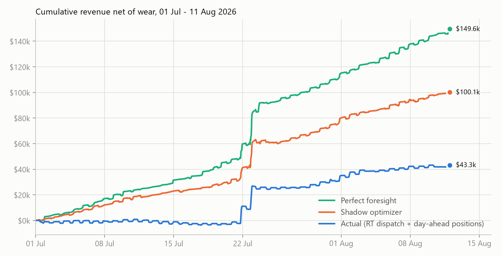
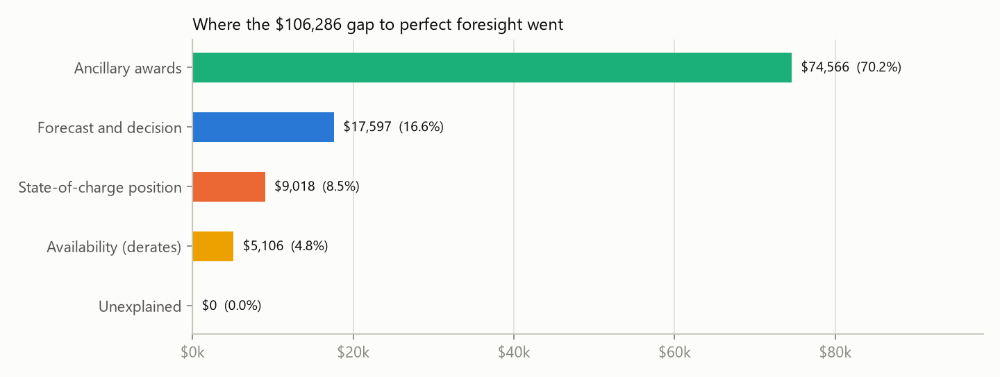
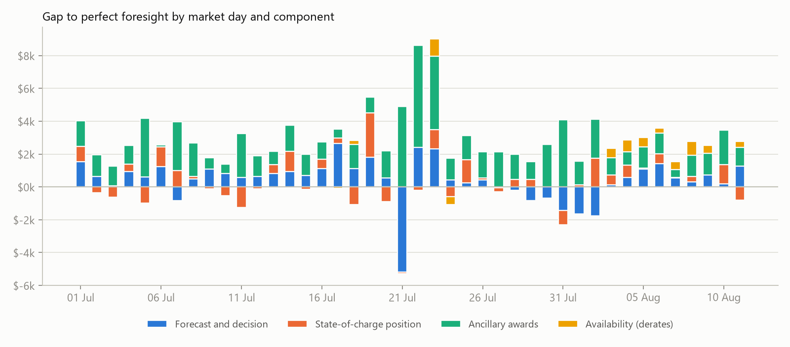
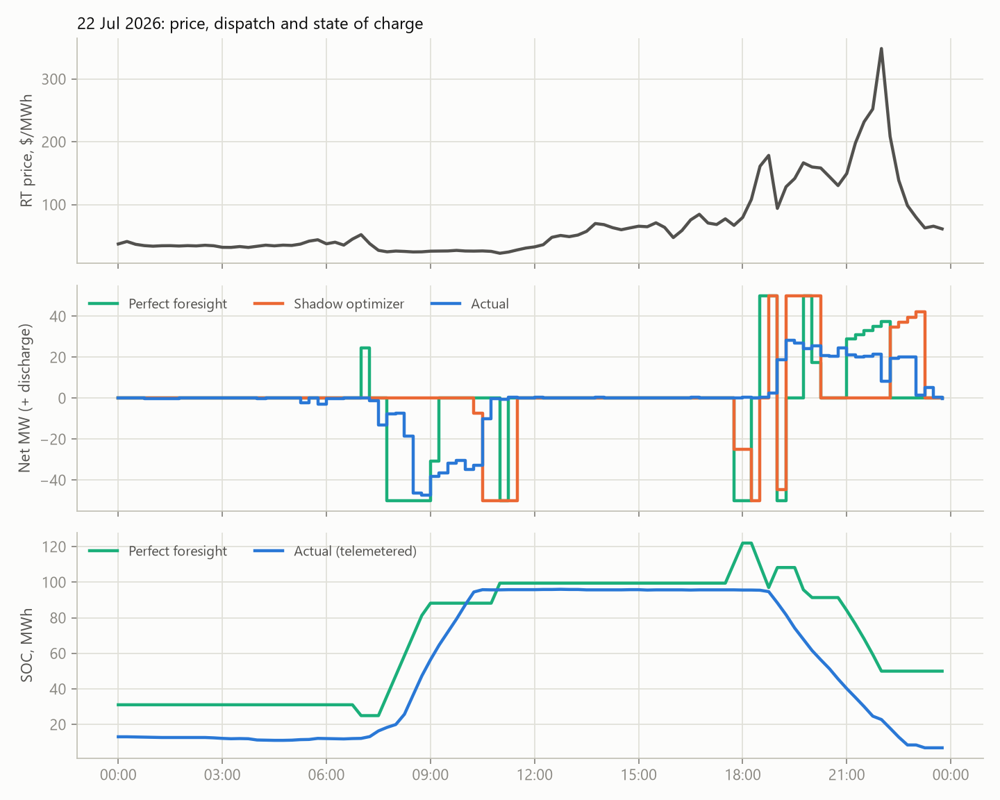

# Public case study: PAD1_ESS_ESR1, 01 Jul to 11 Aug 2026

One ERCOT battery, 42 operating days of ERCOT's own 60-day disclosure data, interval-by-interval attribution against perfect foresight. Every figure carries a label: **REAL** (read from a named ERCOT source), **DERIVED** (computed from REAL inputs by a stated rule) or **ASSUMPTION** (our choice; change it and rerun). Nothing here uses owner data or settlement statements. Generated by `python -m dispatch.attribution.report`.

## Headline

Valued at proxy prices, the asset's dispatch and day-ahead positions over 42 days come to **$43,266** (DERIVED; not settled revenue), which is **28.9%** of the **$149,553** a perfect-foresight operator with the same battery would have earned, net of a $20/MWh discharge wear charge (ASSUMPTION) applied identically to every column. With no wear charge in either number the share is **37.6%**, which is how capture rates are usually quoted. $22,204 of the asset's $43,266 are day-ahead positions (REAL awards and prices, settled against proxy real-time prices).

The shadow optimizer, which sees only public information available at each decision time, would have earned **$100,117** (**66.9%** of perfect foresight) and recovered **53%** of the $106,286 gap, **but only because it sells ancillary capacity**: restricted to energy it earns $24,152 against the asset's $32,454, and without regulation $37,440 against $38,710 (see [Scope sensitivity](#scope-sensitivity)).

| Quantity | Value | Share of perfect foresight | Label |
|---|---|---|---|
| Perfect foresight (same battery, realised prices, free ancillary awards) | $149,553 | 100% | DERIVED |
| Shadow optimizer (seasonal-naive forecast, hourly re-plan) | $100,117 | 66.9% | DERIVED |
| Actual: real-time dispatch and awards, valued at proxy prices | $21,062 | 14.1% | DERIVED |
| Actual: day-ahead positions settled against real time | $22,204 | 14.8% | DERIVED |
| **Actual, total** | **$43,266** | **28.9%** | DERIVED |
| Gap to perfect foresight | $106,286 | 71.1% | DERIVED |

The gap, split by cause (sequential order: availability, then ancillary awards, then SOC position, then the rest):

| Component | USD | Share of gap | What it measures | Label |
|---|---|---|---|---|
| Ancillary awards | $74,566 | 70.2% | Revenue a price-taking operator earns by selling ancillary capacity that the asset did not hold in real time | DERIVED |
| Forecast and decision | $17,597 | 16.6% | Best response to realised prices from the same start SOC, awards and derates, minus what the asset did (includes the $22,204 day-ahead position value) | DERIVED |
| State-of-charge position | $9,018 | 8.5% | Cost of the state of charge the asset carried into each market day, against a free SOC path | DERIVED |
| Availability (derates) | $5,106 | 4.8% | Power derates (HSL/LSL) and reduced Maximum/Minimum SOC the asset reported | DERIVED |
| Unexplained | $0 | 0.0% | Data gaps, and any difference to reported revenue (none supplied) | DERIVED |

**Closure** (|sum of unexplained| / |sum of gap|, PRD target below 5%) is **0.0%** on 100.0% of intervals. See [Gate 2](#gate-2-attribution-closure) before reading that number: it is zero by construction here.

### Read this before quoting the split

* **Ancillary services dominate, and that rests on assumptions.** The benchmark sells regulation up and down at the same time (about 44 MW of each on average) at the real-time clearing price, with no deployment energy, no wear on deployed regulation, and every offered MW awarded. Its ancillary revenue is $91,531; the asset's real-time awards earned $7,366. Against narrower benchmarks the capture rate is 42.9% (regulation excluded) and 41.0% (energy only).
* **The shadow's lead is an ancillary lead.** In the energy-only scope the shadow is behind the asset ($24,152 against $32,454); of the asset's revenue there, $18,757 is a day-ahead energy position that the v1 shadow (real-time only) does not take.
* **Capture depends on the wear assumption.** The same asset scores 37.6% with no wear charge, 37.0% at $10, 28.9% at $20, 14.5% at $30 per MWh discharged: its real-time margin is thin, so a charge per MWh moves the ratio a lot.
* **Prices are a proxy.** Nodal real-time history before 3 Oct 2026 needs an ERCOT API key we do not have. Hub HB_SOUTH real-time SPP stands in for node PAD1_ESS_RN. Measured on the 7-day nodal window the node-minus-hub basis has mean $1.01, MAE $1.78, RMSE $2.93 per MWh and correlation 0.9989; in dollars that could move the asset's revenue by about 11% of the gap ([Proxy price error](#proxy-price-error)).
* **Perfect foresight is a ceiling no operator reaches.** The gap is a distance to that ceiling, not money anyone could have collected.

## The asset

| Item | Value | Label | Source or rule |
|---|---|---|---|
| Resource | PAD1_ESS_ESR1 | REAL | ESR in the NP3-965-ER 60-day SCED disclosure |
| Resource node | PAD1_ESS_RN (LZ_SOUTH) | REAL | DAM disclosure `Settlement Point Name`; listed as a RESOURCE_NODE in NP4-160 (Oct ML1 model) |
| Discharge limit (HSL, maximum) | 50 MW | REAL | max telemetered HSL in the period |
| Charge limit (-LSL, maximum) | 50 MW | REAL | max telemetered -LSL in the period |
| Energy window | 0 to 122 MWh | REAL | max telemetered Maximum SOC |
| Round-trip efficiency | 0.901 (losses on charge) | DERIVED | energy balance of the whole period; per-run medians give 0.938, least squares 0.910 |
| Standing auxiliary draw | 0.4 MW ($11,018 over the period) | DERIVED | median telemetered output at zero base point; removed from dispatch, same in every column |
| Wear cost | $20/MWh discharged | ASSUMPTION | the research arena's value |
| Ancillary products | REGUP, REGDN, RRS, ECRS, NSPIN | REAL | RTC+B products; durations from NPRR1282 (30 min regulation and RRS, 1 h ECRS, 4 h NSPIN) |

### Why this asset

The rules were fixed before the choice was made: 10 to 100 MW (the PRD's first user); present in at least 40 of the staged days; resource node mapped in NP4-160 and priced in the 7-day nodal window; best-hub RMSE at most $5/MWh and absolute bias at most $2/MWh; at least 0.3 discharge cycles a day and real-time ancillary awards in at least 10% of SCED runs (so it trades and the award term is exercised); and the node must hold only this unit. Of 339 ESRs in the disclosure, 124 are in the size range, 22 pass the basis rule, and 3 pass every rule. The lowest-RMSE one is the pilot (`pilot_selection.csv` lists all).

| ESR | MW | MWh | Node | Best hub | RMSE $/MWh | Bias $/MWh | Corr | Cycles/day | Award share |
|---|---|---|---|---|---|---|---|---|---|
| PAD1_ESS_ESR1 | 50 | 122 | PAD1_ESS_RN | HB_SOUTH | 2.93 | +1.01 | 0.9989 | 0.46 | 13% |
| BEXAR_ES_ESR1 | 100 | 100 | BEXAR_ES_RN | HB_SOUTH | 3.09 | +1.01 | 0.9987 | 0.57 | 72% |
| X4_ESR1 | 10 | 9.7 | X443ESRN | HB_SOUTH | 3.20 | +1.00 | 0.9986 | 0.79 | 16% |

## Data and provenance

| Data | Source | Window | Label |
|---|---|---|---|
| Telemetry: net output, base point, HSL/LSL, SOC and limits, RT ancillary awards (288 SCED runs a day) | ERCOT MIS reportTypeId 13052, NP3-965-ER `60d_ESR_Data_in_SCED` | 2026-07-01 to 2026-08-11 | REAL |
| Day-ahead energy and ancillary awards, DAM nodal SPP, MCPC | ERCOT MIS reportTypeId 13051, NP3-966-ER `60d_DAM_ESR_Data` | 2026-07-01 to 2026-08-11 | REAL |
| Real-time energy price | Hub HB_SOUTH 15-minute SPP, NP6-785-ER yearly csv (`rtm2026.csv`) | to 26 Sep 2026 | REAL as a hub price; ASSUMPTION as a stand-in for the node |
| Real-time ancillary prices (MCPC) | NP6-331 / MIS 25570 archive, `as_prices.parquet` market RT_15 | since 5 Dec 2025 (RTC+B) | REAL |
| Node to hub basis | NP6-905 15-minute SPP at resource nodes and hubs (`spp_node.parquet`) | 7 days, 3 to 10 Oct 2026 | REAL |
| Node mapping | NP4-160 `Resource_Node_to_Unit` and settlement_points.csv (Oct ML1) | current model | REAL |

The 84 daily zips used (one SCED and one DAM disclosure per operating day) are listed with url, file name, sha256, bytes and download time in `provenance_files.csv` (staged under `DISPATCH_HOME/staging/ercot-60day/`; D0 adopts staging into the lake). Input fingerprints: actual dispatch `c8306e224e97c1aa`, prices `b65094e40e2693d1`.

## Method in one paragraph

The same LP and accounting (`optimizer/lp.py`) values every column. Perfect foresight solves the whole period at once with free ancillary awards. Four counterfactuals then add one real restriction each: the asset's reported power derates and SOC limits; its actual ancillary awards; its telemetered SOC at the start (and no lower at the end) of each market day; and finally the actual dispatch itself, revalued with the same accounting. Subtracting consecutive stages interval by interval gives components that sum to the gap exactly. The shadow optimizer re-plans every hour over a 48-hour horizon with a seasonal-naive forecast (same time of day on the latest published day) that uses only prices published before each decision, takes the asset's real derates as known, and is revalued on realised prices. Day-ahead positions (awards against the DAM nodal SPP and MCPC, from ERCOT's own report) are part of actual revenue and are attributed to the forecast and decision component.

### Stage totals

| Stage | Net revenue | Energy | Ancillary | Wear | Label |
|---|---|---|---|---|---|
| S0 perfect foresight | $149,553 | $106,212 | $91,531 | -$48,190 | DERIVED |
| S1 + availability | $144,447 | $97,501 | $90,626 | -$43,680 | DERIVED |
| S2 + actual awards | $69,881 | $128,759 | $7,366 | -$66,244 | DERIVED |
| S3 + daily SOC anchor | $60,863 | $111,645 | $7,366 | -$58,147 | DERIVED |
| S4 actual dispatch (RT only) | $21,062 | $61,921 | $7,366 | -$48,224 | DERIVED |
| Shadow optimizer | $100,117 | $55,976 | $87,166 | -$43,024 | DERIVED |

## Results in detail

### Order dependence

The sequential split depends on the order of the chain. The average over all six orderings of the first three stages (Shapley) gives:

| Component | Sequential | Shapley average | Difference |
|---|---|---|---|
| Availability (derates) | $5,106 | $4,571 | -$535 |
| Ancillary awards | $74,566 | $76,316 | $1,750 |
| State-of-charge position | $9,018 | $7,803 | -$1,215 |

The largest difference is $1,750, 1.6% of the gap. The forecast and decision component does not depend on the order (it is always the last stage).

### Scope sensitivity

The benchmark can include every ancillary product (headline) or fewer. Each row restricts the products on both sides: the asset's awards and day-ahead positions outside the scope are left out too.

| Benchmark | Perfect foresight | Actual | Actual capture | Shadow capture | AS | Forecast and decision | SOC | Availability | Shadow recovers gap |
|---|---|---|---|---|---|---|---|---|---|
| energy + all five ancillary products (headline) | $149,553 | $43,266 | 28.9% | 66.9% | $74,566 | $17,597 | $9,018 | $5,106 | 53% |
| energy + RRS, ECRS, NSPIN (regulation excluded) | $90,208 | $38,710 | 42.9% | 41.5% | $13,106 | $25,019 | $9,605 | $3,767 | -2% |
| energy only | $79,214 | $32,454 | 41.0% | 30.5% | $0 | $32,487 | $10,474 | $3,800 | -18% |

### Wear assumption

| Wear $/MWh | Perfect foresight | Actual | Capture | Gap | AS | Forecast and decision | SOC | Availability |
|---|---|---|---|---|---|---|---|---|
| 0 | $243,296 | $91,491 | 37.6% | $151,806 | $58,390 | $74,665 | $8,478 | $10,272 |
| 10 | $182,086 | $67,378 | 37.0% | $114,708 | $64,119 | $30,802 | $12,627 | $7,160 |
| 20 | $149,553 | $43,266 | 28.9% | $106,286 | $74,566 | $17,597 | $9,018 | $5,106 |
| 30 | $132,180 | $19,154 | 14.5% | $113,026 | $83,416 | $18,785 | $7,328 | $3,498 |

### Proxy price error

Hub HB_SOUTH replaces node PAD1_ESS_RN for real-time energy. On the 7-day nodal window (REAL, 717 intervals) the node-minus-hub basis has mean $1.01, MAE $1.78, 95th percentile of the absolute error $5.22, RMSE $2.93 per MWh, correlation 0.9989. To turn that into dollars, each full day of the window's basis (by time of day) is applied to every day of the period and the dispatches are revalued to first order (DERIVED; the day-ahead position settles against the real-time price, so it moves too):

| Basis day | Mean basis $/MWh | Actual | Perfect foresight | Shadow | Gap |
|---|---|---|---|---|---|
| 2026-10-03 | -0.20 | -$2,158 | -$5,207 | -$4,232 | -$3,049 |
| 2026-10-04 | +0.30 | $519 | $418 | $365 | -$101 |
| 2026-10-05 | +2.05 | $4,629 | $8,142 | $6,766 | $3,513 |
| 2026-10-06 | +1.08 | $2,923 | $4,434 | $3,883 | $1,511 |
| 2026-10-07 | +0.20 | $5,992 | $11,733 | $10,160 | $5,741 |
| 2026-10-08 | +2.36 | $11,750 | $21,507 | $18,785 | $9,758 |
| 2026-10-09 | +1.39 | $2,706 | $4,546 | $4,005 | $1,840 |

Across those seven draws the actual's revenue moves by at most $11,750 (11.1% of the gap) and the gap itself by at most $9,758 (9.2%). Seven October days are a thin sample for July and August, so there is a second check on the period's own hours.

**Same-period check with day-ahead prices (REAL).** The same 60-day DAM disclosure carries ERCOT's day-ahead price at every hub, so for the 1008 hours of the case study the node's day-ahead price can be compared with HB_SOUTH's: mean difference $2.95, MAE $2.96, 95th percentile $10.26, RMSE $6.59 per MWh, correlation 0.9650. Applying that hourly basis to the real-time revaluation moves the actual by $6,404 (6.0% of the gap), perfect foresight by $7,216, the shadow by $9,225 and the gap by $813. Day-ahead is not real-time, so this bounds the proxy rather than measuring it.

## Gate 2: attribution closure

| Test | Result | Pass |
|---|---|---|
| Components sum to the gap in every interval (max abs error) | 2.3e-13 USD | PASS |
| Closure, PRD definition (abs of summed unexplained over abs of summed gap), target < 5% | 0.0% | PASS |
| Strict closure (summed absolute unexplained over summed absolute gap) | 0.0% | PASS |
| Data coverage (intervals with actual telemetry and prices) | 100.0% | PASS |
| Stress: revenue the hub proxy could move, real-time basis of 7 October days (worst draw), share of the gap | 11.1% | FAIL |
| Stress: same, day-ahead basis of the case-study hours, share of the gap | 6.0% | FAIL |

Separately, `tests/test_attribution.py` checks the engine on synthetic assets whose answer is known (actual equal to perfect foresight gives no gap; idle gives gap equal to perfect foresight; injected derates and award differences land in their own components; closure below 5% on clean data).

**Gate 2 status: PASS on the PRD definition** (unexplained 0.0% of the gap, target below 5%), **with one qualification stated plainly.** Public data holds no reported or settled revenue to compare with, so the actual revenue IS the revaluation of telemetry and the unexplained term is zero apart from data gaps: here closure measures coverage, not accuracy. It becomes a real test only when an owner supplies settlement statements (`reported_usd` in `engine.attribute`).

The stress row is the honest substitute: the largest share of the gap that the hub-for-node price proxy alone could move is 11.1%, which is ABOVE the 5% target. So with hub prices the actual revenue itself is only known to about that precision; closure below 5% against settled revenue is not demonstrated until the node price or a settlement export is used.

## The 20 largest missed intervals

Each row is one 15-minute interval (Central time). Components are in dollars and sum to the gap; the explanation uses only measured dispatch, awards, SOC and derates. The full interval list is `attribution_intervals.csv`.

| # | When (CPT) | Gap | Forecast/decision | SOC | AS | Avail. | Dominant | Explanation |
|---|---|---|---|---|---|---|---|---|
| 1 | 22 Jul 22:00 | $2,801 | $1,547 | $0 | $1,254 | $0 | forecast | RT price $349/MWh. Perfect foresight moves +38 MW, the asset moved +8 MW. Forecast or decision: from the asset's own start SOC, awards and derates the best response moves +25 MW. The shadow optimizer moved +0 MW. This term is $1,547 of the $2,801 missed in the interval. |
| 2 | 22 Jul 18:45 | $1,910 | $861 | $0 | $1,050 | $0 | as | RT price $178/MWh. Perfect foresight moves +50 MW, the asset moved +2 MW. Ancillary awards: the asset held 25 MW against 50 MW in the free plan; with the actual awards fixed the best plan moves +25 MW instead of +50 MW. This term is $1,050 of the $1,910 missed in the interval. |
| 3 | 22 Jul 18:30 | $1,736 | $1,399 | $0 | $337 | $0 | forecast | RT price $161/MWh. Perfect foresight moves +50 MW, the asset moved +0 MW. Forecast or decision: from the asset's own start SOC, awards and derates the best response moves +41 MW. The shadow optimizer moved +0 MW. This term is $1,399 of the $1,736 missed in the interval. |
| 4 | 22 Jul 21:45 | $1,423 | $326 | $0 | $1,098 | $0 | as | RT price $252/MWh. Perfect foresight moves +35 MW, the asset moved +22 MW. Ancillary awards: the asset held 30 MW against 65 MW in the free plan; with the actual awards fixed the best plan moves +20 MW instead of +35 MW. This term is $1,098 of the $1,423 missed in the interval. |
| 5 | 22 Jul 21:30 | $1,340 | $367 | $0 | $973 | $0 | as | RT price $232/MWh. Perfect foresight moves +33 MW, the asset moved +21 MW. Ancillary awards: the asset held 28 MW against 67 MW in the free plan; with the actual awards fixed the best plan moves +22 MW instead of +33 MW. This term is $973 of the $1,340 missed in the interval. |
| 6 | 21 Jul 22:15 | $1,138 | $656 | $0 | $481 | $0 | forecast | RT price $114/MWh. Perfect foresight moves +35 MW, the asset moved -0 MW. Forecast or decision: from the asset's own start SOC, awards and derates the best response moves +25 MW. The shadow optimizer moved +0 MW. This term is $656 of the $1,138 missed in the interval. |
| 7 | 21 Jul 22:30 | $1,074 | $598 | $0 | $476 | $0 | forecast | RT price $109/MWh. Perfect foresight moves +37 MW, the asset moved -0 MW. Forecast or decision: from the asset's own start SOC, awards and derates the best response moves +25 MW. The shadow optimizer moved +0 MW. This term is $598 of the $1,074 missed in the interval. |
| 8 | 22 Jul 21:15 | $1,005 | $324 | $0 | $681 | $0 | as | RT price $198/MWh. Perfect foresight moves +31 MW, the asset moved +20 MW. Ancillary awards: the asset held 25 MW against 69 MW in the free plan; with the actual awards fixed the best plan moves +25 MW instead of +31 MW. This term is $681 of the $1,005 missed in the interval. |
| 9 | 21 Jul 18:45 | $940 | $871 | $0 | $69 | $0 | forecast | RT price $89/MWh. Perfect foresight moves +50 MW, the asset moved +0 MW. Forecast or decision: from the asset's own start SOC, awards and derates the best response moves +50 MW. The shadow optimizer moved +0 MW. This term is $871 of the $940 missed in the interval. |
| 10 | 23 Jul 15:30 | $762 | $447 | $0 | $8 | $307 | forecast | RT price $80/MWh. Perfect foresight moves +50 MW, the asset moved +0 MW. Forecast or decision: from the asset's own start SOC, awards and derates the best response moves +30 MW. The shadow optimizer moved +14 MW. This term is $447 of the $762 missed in the interval. |
| 11 | 23 Jul 15:15 | $739 | $442 | $0 | $1 | $296 | forecast | RT price $79/MWh. Perfect foresight moves +50 MW, the asset moved +0 MW. Forecast or decision: from the asset's own start SOC, awards and derates the best response moves +30 MW. The shadow optimizer moved +0 MW. This term is $442 of the $739 missed in the interval. |
| 12 | 23 Jul 16:15 | $733 | $733 | $0 | $0 | $0 | forecast | RT price $79/MWh. Perfect foresight moves +50 MW, the asset moved +0 MW. Forecast or decision: from the asset's own start SOC, awards and derates the best response moves +50 MW. The shadow optimizer moved +0 MW. This term is $733 of the $733 missed in the interval. |
| 13 | 23 Jul 14:30 | $733 | $436 | $0 | $4 | $294 | forecast | RT price $78/MWh. Perfect foresight moves +50 MW, the asset moved +0 MW. Forecast or decision: from the asset's own start SOC, awards and derates the best response moves +30 MW. The shadow optimizer moved +0 MW. This term is $436 of the $733 missed in the interval. |
| 14 | 21 Jul 22:45 | $732 | $395 | $0 | $337 | $0 | forecast | RT price $81/MWh. Perfect foresight moves +40 MW, the asset moved -0 MW. Forecast or decision: from the asset's own start SOC, awards and derates the best response moves +25 MW. The shadow optimizer moved +0 MW. This term is $395 of the $732 missed in the interval. |
| 15 | 11 Aug 21:15 | $730 | $719 | $0 | $11 | $0 | forecast | RT price $77/MWh. Perfect foresight moves +50 MW, the asset moved -0 MW. Forecast or decision: from the asset's own start SOC, awards and derates the best response moves +50 MW. The shadow optimizer moved +0 MW. This term is $719 of the $730 missed in the interval. |
| 16 | 05 Aug 21:15 | $724 | $711 | $0 | $13 | $0 | forecast | RT price $77/MWh. Perfect foresight moves +50 MW, the asset moved -0 MW. Forecast or decision: from the asset's own start SOC, awards and derates the best response moves +50 MW. The shadow optimizer moved +50 MW. This term is $711 of the $724 missed in the interval. |
| 17 | 22 Jul 19:45 | $724 | -$109 | $0 | $833 | $0 | as | RT price $167/MWh. Perfect foresight moves +50 MW, the asset moved +24 MW. Ancillary awards: the asset held 25 MW against 50 MW in the free plan; with the actual awards fixed the best plan moves +25 MW instead of +50 MW. This term is $833, more than the $724 missed in the interval (other terms offset it). |
| 18 | 23 Jul 14:15 | $695 | $416 | $0 | $1 | $278 | forecast | RT price $75/MWh. Perfect foresight moves +50 MW, the asset moved +0 MW. Forecast or decision: from the asset's own start SOC, awards and derates the best response moves +30 MW. The shadow optimizer moved +0 MW. This term is $416 of the $695 missed in the interval. |
| 19 | 23 Jul 16:45 | $692 | $686 | $0 | $6 | $0 | forecast | RT price $75/MWh. Perfect foresight moves +50 MW, the asset moved -0 MW. Forecast or decision: from the asset's own start SOC, awards and derates the best response moves +50 MW. The shadow optimizer moved +0 MW. This term is $686 of the $692 missed in the interval. |
| 20 | 23 Jul 15:45 | $687 | $406 | $0 | $6 | $276 | forecast | RT price $74/MWh. Perfect foresight moves +50 MW, the asset moved +0 MW. Forecast or decision: from the asset's own start SOC, awards and derates the best response moves +30 MW. The shadow optimizer moved +0 MW. This term is $406 of the $687 missed in the interval. |

## Limits

* **No settled revenue.** Revenue is telemetered output times a hub price plus ERCOT's disclosed day-ahead awards; the real settlement uses metered energy at the node and may include items we cannot see.
* **Hub proxy.** See above; the proxy error moves every column, the gap less.
* **Benchmark assumptions.** Price-taking, every offered MW awarded, no deployment energy or wear for ancillary services, regulation up and down held together, conservative power limits (discharge plus up awards at most the limit). Real SCED and the asset's own offers would differ.
* **Actual versus the LP's physics.** On 42 checked days the actual flows run through the LP's dynamics from the telemetered start SOC end within 1.6 MWh of the telemetered end SOC on average (worst 6.0). In a few intervals the asset's discharge plus up awards exceeded its HSL by up to 15 MW (ERCOT counts headroom against base point, not telemetry); those are not clipped, only reported.
* **Shadow.** It takes derates as known at decision time (an ASSUMPTION), assumes full awards at the clearing price, and uses a seasonal-naive forecaster; a trained model would change it. It ran 1008 plans, 0 failed.
* **One asset, 42 days.** Not a fleet statistic and not a forecast.

## Cross-check of the LP against the research arena

On 300 historical zone-days (8 ERCOT load zones, 2011 to 2026, includes the highest-spread and negative-price days) the platform LP and the arena's dynamic programme agree: LP minus DP is between -3.6e-12 and 7.3e-12 $ per MW-day (total relative difference 0.0e+00). With the guard-compatible grid-side charge limit the LP earns 0.6% less than the DP in total (up to 15% on days when the charge rate binds), because the arena caps stored energy per interval where the guard caps grid power. See `notes/d1b.md`.

## Files

* `case_study.md`
* `summary.json`
* `attribution_intervals.csv`
* `attribution_daily.csv`
* `top20_missed_intervals.csv`
* `scope_variants.csv`
* `wear_sensitivity.csv`
* `proxy_sensitivity.csv`
* `pilot_selection.csv`
* `provenance_files.csv`
* `dp_crosscheck.csv`
* `fig_cumulative.png`
* `fig_gap_components.png`
* `fig_daily_components.png`
* `fig_example_day.png`

Run time: 360 s.
